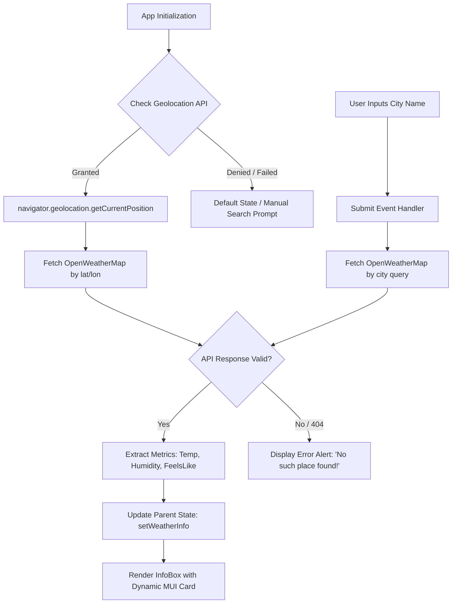

# 🌦️ WeatherFinder — Real-Time Weather Application

A modern, responsive React 19 application that delivers real-time weather analytics by automatically detecting the user's geolocation or providing instant search capabilities for any city across the globe. Built with clean component architecture, Material-UI components, and integration with the OpenWeatherMap API.

---

## 📑 Table of Contents
- [Overview](#-overview)
- [Key Features](#-key-features)
- [System Architecture & Flow](#-system-architecture--flow)
- [Tech Stack](#-tech-stack)
- [Project Structure](#-project-structure)
- [Getting Started](#-getting-started)
- [Environment Configuration](#-environment-configuration)
- [Engineering Highlights & Interview Talking Points](#-engineering-highlights--interview-talking-points)
- [Future Improvements](#-future-improvements)
- [Author & Contact](#-author--contact)

---

## 🌟 Overview

**WeatherFinder** solves the common UX friction in weather apps by prioritizing automatic device geolocation upon initial render, while maintaining a robust fallback to manual city search. It handles edge cases like denied location permissions, non-existent locations, and network errors gracefully with clear user feedback.

---

## ✨ Key Features

- **🌐 Auto Geolocation Detection:** Prompts for browser geolocation (`navigator.geolocation`) on load to fetch instant hyper-local weather conditions without requiring user input.
- **🔍 Instant City Search:** Allows users to query any global city name with URL-encoded parameters and error validation.
- **📊 Comprehensive Metrics:** Displays current temperature, minimum/maximum daily temperatures, humidity percentage, "feels like" perception, and atmospheric condition descriptions.
- **🎨 Dynamic Weather Cards:** Visual weather cards styled with Material-UI (MUI v6) with icons indicating rain, cold, haze, or sunshine based on condition thresholds.
- **🛡️ Defensive Error Handling:** Handles non-200 HTTP responses (e.g. 404 City Not Found) and network failures with user-friendly alerts.

---

## 🏗️ System Architecture & Flow



---

## 🛠️ Tech Stack

| Technology | Role | Details |
|---|---|---|
| **React 19** | Core Frontend Library | Component-driven UI, state management via Hooks (`useState`, `useEffect`) |
| **Vite 7** | Build Tool & Bundler | Ultra-fast HMR and optimized production bundling |
| **Material-UI (MUI v6)** | UI Component Library | Accessible buttons, textfields, and cards |
| **OpenWeatherMap REST API** | Weather Data Provider | Real-time weather endpoints (`/data/2.5/weather`) |
| **HTML5 Geolocation API** | Browser Location Service | Asynchronous coordinate detection (`lat`, `lon`) |

---

## 📁 Project Structure

```
WeatherFinder/
├── public/                 # Static assets
├── src/
│   ├── assets/             # Images and visual media
│   ├── App.css             # Main application styles
│   ├── App.jsx             # Root layout container
│   ├── InfoBox.jsx         # Card display for temperature & conditions
│   ├── main.jsx            # React 19 DOM bootstrap
│   ├── SearchBox.jsx       # Geolocation logic & city search form
│   └── WeatherApp.jsx      # Central state container (Lifting state up)
├── .env.example            # Environment variables template
├── .gitignore              # Ignored files (node_modules, .env)
├── index.html              # HTML entrypoint
├── package.json            # Project manifest & dependencies
└── vite.config.js          # Vite compilation settings
```

---

## 🚀 Getting Started

### 1. Prerequisites
- **Node.js**: v18.0.0 or higher
- **npm** or **yarn**
- **OpenWeatherMap API Key**: Free registration at [OpenWeatherMap](https://openweathermap.org/api)

### 2. Installation
```bash
# Clone repository
git clone https://github.com/aditya-life/WeatherFinder.git

# Enter project directory
cd WeatherFinder

# Install dependencies
npm install
```

### 3. Setup Environment Variables
Create a `.env` file in the root directory:
```bash
cp .env.example .env
```
Populate the variables:
```env
VITE_API_URL=https://api.openweathermap.org/data/2.5/weather
VITE_API_KEY=your_actual_openweathermap_api_key_here
```

### 4. Run Development Server
```bash
npm run dev
```
Open your browser at `http://localhost:5173`.

### 5. Build for Production
```bash
npm run build
npm run preview
```

---

## 🎯 Engineering Highlights & Interview Talking Points

When presenting this project in a frontend or full-stack engineering interview:

1. **State Lifting Pattern (`WeatherApp.jsx` -> `SearchBox.jsx` & `InfoBox.jsx`):**
   - *Explanation:* Rather than maintaining decoupled states, state is lifted to the common parent (`WeatherApp`). `SearchBox` acts as the producer invoking `setWeatherInfo`, while `InfoBox` acts as the pure presentation consumer.
2. **Asynchronous Geolocation with Promises:**
   - *Explanation:* Wrapped `navigator.geolocation.getCurrentPosition` in a native ES6 Promise to integrate smoothly into the modern `async/await` and `.then()` execution pipelines.
3. **Defensive API Error Handling:**
   - *Explanation:* OpenWeatherMap does not throw a network error on 404 (e.g. unknown city name); it returns `{ cod: "404", message: "city not found" }` with an HTTP 404 status. The code explicitly checks `response.ok` and status codes before parsing JSON fields to prevent runtime `TypeError` crashes.
4. **Environment Isolation with Vite:**
   - *Explanation:* Leveraged Vite's `import.meta.env.VITE_*` convention to prevent hardcoded API tokens from entering the version control system.

---

## 🔮 Future Improvements

- [ ] 5-day / 3-hour forecast toggle using OpenWeatherMap Forecast API.
- [ ] Celsius / Fahrenheit unit conversion toggle.
- [ ] Search autocomplete with a debounce hook for city suggestions.
- [ ] Offline caching via Service Worker.

---

## 👤 Author & Contact

**Aditya Kumar**
- **GitHub:** [@aditya-life](https://github.com/aditya-life)
- **LinkedIn:** [Aditya Kumar](https://www.linkedin.com/in/aditya-life)
- **Email:** aditya12186@gmail.com
